# Multi-Identity Banking con procesadores: rediseño con herencia y polimorfismo

Rediseño del Problema 4 de Week #9 (*Multi-Identity Banking with Processors*). El objetivo es eliminar el código espagueti que se formaba alrededor de `Identity`, los procesadores, `BankOperation` y `BankingService`, aplicando herencia, polimorfismo y wrappers.

## Diagrama de clases del nuevo diseño

```mermaid
classDiagram
    direction TB

    class IdentityType {
        <<enumeration>>
        PERSONAL
        BUSINESS
        MINOR
        FOREIGN_RESIDENT
    }
    class OperationType {
        <<enumeration>>
        DEPOSIT
        WITHDRAWAL
        DOMESTIC_TRANSFER
        INTERNATIONAL_TRANSFER
        PAYROLL
    }

    class User {
        -String id
        -String fullName
        -List~Identity~ identities
        +addIdentity(Identity)
        +findIdentity(IdentityType) Identity
    }

    class Identity {
        <<abstract>>
        -String documentNumber
        -String accountNumber
        +getType()* IdentityType
        +getDailyLimit()* double
        +canPerform(OperationType)* boolean
        +canUseProcessor(String) boolean
        +validate(BankOperation, LocalDate) String
    }
    class PersonalIdentity {
        +getType() IdentityType
        +getDailyLimit() double
        +canPerform(OperationType) boolean
    }
    class BusinessIdentity {
        -String companyName
        +getType() IdentityType
        +getDailyLimit() double
        +canPerform(OperationType) boolean
        +validate(BankOperation, LocalDate) String
    }
    class MinorIdentity {
        -String guardianUserId
        +getType() IdentityType
        +getDailyLimit() double
        +canPerform(OperationType) boolean
        +canUseProcessor(String) boolean
    }
    class ForeignResidentIdentity {
        -String countryCode
        -LocalDate residencyExpiresOn
        +getType() IdentityType
        +getDailyLimit() double
        +canPerform(OperationType) boolean
        +validate(BankOperation, LocalDate) String
    }

    class BankOperation {
        <<abstract>>
        -double amount
        -String currency
        -String approvalCode
        +getType()* OperationType
        +getTotal() double
        +countsTowardsLimit() boolean
    }
    class Deposit {
        +countsTowardsLimit() boolean
    }
    class Withdrawal
    class Transfer {
        <<abstract>>
        -String destinationAccount
    }
    class DomesticTransfer
    class InternationalTransfer {
        -String destinationBic
    }
    class Payroll {
        -List~String~ payees
        +getTotal() double
    }

    class PaymentProcessor {
        <<interface>>
        +supports(BankOperation) boolean
        +calculateFee(BankOperation) double
        +process(Identity, BankOperation) ProcessorResult
    }
    class NationalBankAdapter {
        -NationalBankProcessor bank
        +process(Identity, BankOperation) ProcessorResult
    }
    class PacificBankAdapter {
        -PacificBankProcessor bank
        +process(Identity, BankOperation) ProcessorResult
    }
    class SwiftGatewayAdapter {
        -SwiftGatewayProcessor gateway
        +process(Identity, BankOperation) ProcessorResult
    }

    class NationalBankProcessor {
        <<external>>
        +postTransaction(String, String, double, String) String
    }
    class PacificBankProcessor {
        <<external>>
        +submit(String, String, long, String) String
        +submitPayroll(String, List~String~, long) String
    }
    class SwiftGatewayProcessor {
        <<external>>
        +sendWire(String, String, String, double, String) String
    }

    note for NationalBankAdapter "process() llama a postTransaction()<br>null se traduce a un fallo"
    note for PacificBankAdapter "process() llama a submit() o submitPayroll()<br>convierte el monto a centavos<br>'REJECTED:...' se traduce a un fallo"
    note for SwiftGatewayAdapter "process() llama a sendWire()<br>la excepción se traduce a un fallo"

    class ProcessorResult
    class ProcessorRegistry {
        -Map~String, PaymentProcessor~ processors
        +register(PaymentProcessor)
        +find(String) PaymentProcessor
    }
    class BankingService {
        +BankingService(ProcessorRegistry, DailyUsageTracker, AuditLog)
        +execute(User, IdentityType, BankOperation, String, LocalDate) OperationResult
    }
    class DailyUsageTracker
    class AuditLog
    class OperationResult

    User *-- "1..*" Identity
    Identity <|-- PersonalIdentity
    Identity <|-- BusinessIdentity
    Identity <|-- MinorIdentity
    Identity <|-- ForeignResidentIdentity
    Identity ..> IdentityType

    BankOperation <|-- Deposit
    BankOperation <|-- Withdrawal
    BankOperation <|-- Transfer
    BankOperation <|-- Payroll
    Transfer <|-- DomesticTransfer
    Transfer <|-- InternationalTransfer
    BankOperation ..> OperationType

    PaymentProcessor <|.. NationalBankAdapter
    PaymentProcessor <|.. PacificBankAdapter
    PaymentProcessor <|.. SwiftGatewayAdapter
    NationalBankAdapter *-- NationalBankProcessor : envuelve
    PacificBankAdapter *-- PacificBankProcessor : envuelve
    SwiftGatewayAdapter *-- SwiftGatewayProcessor : envuelve
    PaymentProcessor ..> ProcessorResult

    ProcessorRegistry o-- "1..*" PaymentProcessor
    BankingService o-- ProcessorRegistry
    BankingService o-- DailyUsageTracker
    BankingService o-- AuditLog
    BankingService ..> User
    BankingService ..> BankOperation
    BankingService ..> OperationResult
```



Los métodos marcados con `*` son abstractos, así que cada subclase está obligada a implementarlos. Las clases con `<<external>>` son las de los bancos, que no se pueden modificar.

## Explicación de la mejora

En el diseño original, toda la lógica del sistema estaba concentrada en `BankingService`. Esa clase revisaba qué podía hacer cada tipo de identidad, cuál era su límite diario, qué operaciones aceptaba cada banco, cuánto cobraba cada uno y cómo había que llamarlo. Todo esto se resolvía con `switch` sobre el tipo de identidad o sobre el nombre del procesador, repartidos en varios métodos. Por eso, agregar un tipo nuevo obligaba a buscar y editar cada uno de esos `switch`. La idea del nuevo diseño es que cada clase sea responsable de lo que le corresponde, para que el servicio solo tenga que coordinar.

El primer cambio está en las identidades. Antes, `Identity` era una sola clase con un código de tipo y con todos los atributos que *cualquier* identidad podría llegar a necesitar, de modo que un menor cargaba con un `companyName` y una empresa con una fecha de vencimiento de residencia. Ahora `Identity` es una clase abstracta que guarda solo lo común (número de documento y cuenta), y cada tipo de identidad es una subclase con sus propios atributos: `PersonalIdentity`, `BusinessIdentity`, `MinorIdentity` y `ForeignResidentIdentity`. Cada subclase sabe cuál es su límite diario, qué operaciones puede realizar y si tiene reglas extra. La empresa revisa el código de aprobación para montos mayores a 10,000 y el residente extranjero revisa que su permiso no haya vencido. Como los datos obligatorios se piden en el constructor, ya no se puede crear un menor sin guardián ni un residente sin fecha de vencimiento, y esas revisiones dejan de hacerse en tiempo de ejecución.

La regla de que los menores solo pueden usar National Bank queda en `MinorIdentity`, sobrescribiendo `canUseProcessor`. Es una restricción sobre quién es el cliente, igual que su límite o sus operaciones permitidas, y así los bancos no necesitan conocer los tipos de cliente. Los enums `IdentityType` y `OperationType` se mantienen, pero ahora solo funcionan como etiquetas: cada subclase devuelve la suya en `getType()`, lo que permite que `User` encuentre la identidad que se le pide sin depender de ningún `switch`.

Con las operaciones pasaba algo parecido. `BankOperation` tenía atributos que solo aplicaban a ciertos casos, como el BIC en un depósito o la lista de empleados en un retiro. Ahora es una clase abstracta con lo común (monto, moneda y código de aprobación), y cada tipo de operación es una subclase con solo los datos que necesita. `Transfer` agrupa lo que comparten las dos transferencias, que es la cuenta destino, y `Payroll` es dueña de su lista de empleados y calcula su propio total (monto por empleado × cantidad de empleados). `Deposit` indica que no cuenta para el límite diario.

El cambio más importante está en los procesadores. Cada banco tiene su propia API, con nombres de métodos, unidades y formas de fallar distintas, y como vienen de entidades externas no se pueden modificar. Antes, `BankingService` tenía que conocer todos esos detalles. Ahora existe la interfaz `PaymentProcessor`, que define un contrato común, y un wrapper por cada banco que la implementa: `NationalBankAdapter`, `PacificBankAdapter` y `SwiftGatewayAdapter`. Cada wrapper sabe qué operaciones soporta su banco y cuánto cobra, y se encarga de llamarlo. Además, `ProcessorRegistry` guarda los procesadores disponibles y entrega el que se pide por nombre, lo que reemplaza el `switch` que antes elegía el banco.

Por último, `BankingService` ya no crea sus procesadores con `new`: recibe el registro, el control de uso diario y la bitácora por su constructor. Esto permite probarlo por separado, usando procesadores de prueba en lugar de los reales. Lo que le queda por hacer es una secuencia corta de pasos: buscar la identidad, pedirle que valide la operación, revisar el límite diario, obtener el procesador y ejecutarlo, y registrar el resultado en la bitácora.

## Nota sobre los wrappers

Un wrapper es una clase que envuelve a otra para darle una forma distinta de usarse, sin cambiar la clase original. En este caso, cada wrapper contiene al procesador de su banco (la relación "envuelve" del diagrama) e implementa el método unificado `process(Identity, BankOperation)`. Por fuera, los tres wrappers se ven iguales. Por dentro, cada uno llama al método original de su banco, convierte los datos al formato que ese banco espera y traduce su forma particular de fallar a un `ProcessorResult` común. Así, `BankingService` nunca sabe qué banco hay detrás.

Por ejemplo, una transferencia por Pacific Bank seguiría este flujo:

`BankingService` llama a `process()` → `PacificBankAdapter` convierte el monto a centavos → llama a `submit()` de `PacificBankProcessor` → recibe la respuesta y, si empieza con `"REJECTED:"`, la traduce a un fallo → devuelve un `ProcessorResult` al servicio.

Con National Bank el flujo es el mismo, pero el wrapper llama a `postTransaction()` y traduce un `null` a fallo. Con SWIFT, el wrapper llama a `sendWire()` y atrapa la excepción para convertirla en fallo.

## Ejemplo del uso del polimorfismo en el nuevo diseño

Uno de los ejemplos más sencillos de polimorfismo en este diseño está en las identidades. `User` guarda una lista de tipo `Identity`, pero cada objeto de esa lista es en realidad una de las subclases. Cuando el servicio llama a un método sobre una variable de tipo `Identity`, Java ejecuta la versión de la subclase real del objeto, sin que nadie tenga que preguntar de qué tipo es:

```java
Identity ana = new BusinessIdentity("3-101-123456", "ACC-1", "Rojas S.A.");
Identity leo = new MinorIdentity("1-2345-6789", "ACC-2", "u-100");

ana.getDailyLimit();   // 50000, ejecuta la versión de BusinessIdentity
leo.getDailyLimit();   // 100, ejecuta la versión de MinorIdentity
```

Dentro de `BankingService` esto se aprovecha en líneas como las siguientes, donde la misma llamada se comporta distinto según el objeto real:

```java
double limit = identity.getDailyLimit();                          // depende del tipo de identidad
double total = operation.getTotal();                              // Payroll multiplica por empleados
ProcessorResult result = processor.process(identity, operation);  // cada wrapper llama a su banco
```

Lo mismo aplica a las reglas extra: `BusinessIdentity` y `ForeignResidentIdentity` sobrescriben `validate()` para agregar sus revisiones propias, mientras que las demás identidades usan la versión de la clase padre.

## Pequeña comparación entre el diseño anterior y el nuevo

En el diseño anterior, agregar una identidad "Senior citizen" con límite de 3,000 obligaba a editar cuatro métodos de `BankingService`, y agregar un procesador "Crypto" obligaba a editar otros tres, además de crear el atributo nuevo en el servicio. Con el nuevo diseño, la identidad nueva es una sola clase que hereda de `Identity` más una constante en el enum, y el procesador nuevo es un solo wrapper que implementa `PaymentProcessor` y se registra en `ProcessorRegistry`. En ninguno de los dos casos hay que tocar `BankingService`: agregar un tipo nuevo significa agregar una clase, no buscar y editar condiciones por todo el código.
